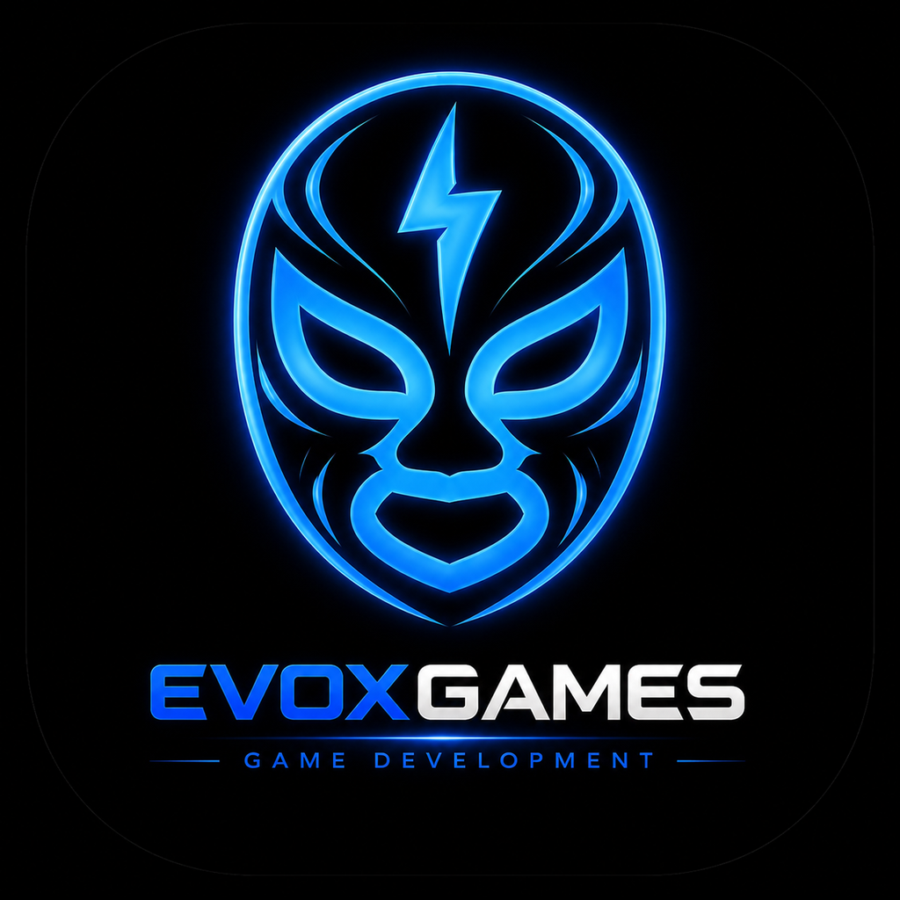
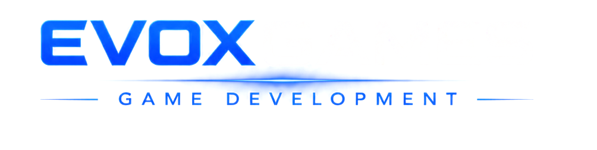

<p align="center">
  
</p>

<h1 align="center">Candle Translator</h1>
<p align="center"><b>by EVOX Games Development</b> · versión / version <b>0.1.0</b></p>

<p align="center">
  Lee las velas y te explica en lenguaje sencillo lo que está pasando.<br>
  <i>Reads the candles and explains what is happening in plain language.</i>
</p>

<p align="center">
  <a href="#español">Español</a> · <a href="#english">English</a>
</p>

---

## Español

### ¿Qué es?

**Candle Translator** es una ventanita que se queda abierta junto a tu gráfica. Escribes una cripto (BTC, ETH, SOL…) y el programa:

- Lee **cuatro temporalidades a la vez** (15 min, 1 h, 4 h y diario) y te dice si **se apoyan o se contradicen**.
- Marca los **pisos y techos** (soportes y resistencias) y los **patrones de velas** (martillo, envolvente, doji…).
- Lo explica en **español sencillo**. Con **"Explícame más"** te da el detalle de cada temporalidad.
- Te muestra una **mini gráfica** con lo importante marcado, para que aprendas a verlo tú solo.
- **Te avisa en vivo** si pasa algo importante: rompe un piso o un techo, hay un movimiento brusco o entra volumen muy alto.
- Si pasas el mouse sobre un término (martillo, piso, media móvil…), te explica qué significa.
- Funciona en **español e inglés**.

Incluye oro tokenizado (**PAXG** y **XAUT**), con una nota sobre en qué se diferencia del oro normal.

Es **gratis**, no necesita cuenta y no se conecta a tu exchange: solo lee precios públicos.

> **Importante:** Candle Translator **explica** lo que muestra la gráfica. **No es asesoría financiera** y nunca te dice qué comprar o vender. La decisión siempre es tuya.

### Guía de instalación

#### Windows

1. Entra a **[Releases](../../releases/latest)** y descarga **`CandleTranslator-Windows-0.1.0.exe`**.
2. Abre el archivo descargado.
3. Si aparece **"Windows protegió su PC"**, haz clic en **"Más información"** y luego en **"Ejecutar de todos modos"**. Sale porque el programa es gratuito y no está firmado con un certificado de pago.
4. Se instala solo y se abre. La próxima vez lo encuentras en el menú Inicio como **Candle Translator**.

#### Mac

1. Entra a **[Releases](../../releases/latest)** y descarga **`CandleTranslator-Mac-0.1.0.dmg`**.
2. Abre el archivo y arrastra **Candle Translator** a la carpeta **Aplicaciones**.
3. Ábrelo desde Aplicaciones. La primera vez, Mac te dirá que no puede verificarlo: cierra el aviso.
4. Ve a **Configuración del Sistema → Privacidad y seguridad**, baja hasta el mensaje de *Candle Translator* y haz clic en **"Abrir de todos modos"**.
5. Listo: desde ahí ya abre normal.

Si Mac dice que la app **"está dañada"**, abre la app **Terminal**, pega esta línea, presiona Enter y vuelve a abrirla:

```
xattr -cr "/Applications/Candle Translator.app"
```

#### Cómo se usa

1. Arriba a la izquierda escribe o elige la cripto (por ejemplo **BTC**) y presiona Enter.
2. Lee el resumen. Si quieres más detalle, presiona **"Explícame más"**.
3. Cambia la mini gráfica entre **15 min, 1 h, 4 h y Diario** con las pestañas.
4. Con el interruptor de arriba a la derecha decides si la ventana se queda **siempre encima** de las demás.

### Actualizaciones y próximas mejoras

Esta es la **versión 0.1.0**, la primera. Vamos a seguir subiendo mejoras.

- **En Windows** el programa **se actualiza solo**: descarga la versión nueva y la instala al cerrarlo.
- **En Mac** te avisa cuando hay una versión nueva, con un botón para descargarla.
- La versión que tienes aparece en la parte de abajo de la ventana.

**Lo que viene:**

- Avisos de **noticias y datos económicos** que mueven el mercado (Fed, inflación, empleo de EE. UU.).
- Conectar **tu propia IA** (opcional) para explicaciones más completas y resumen de noticias.
- **Ciclos de halving de Bitcoin:** el historial completo y la comparación de cada ciclo.
- **Ayuda con tu operación:** dónde corre peligro tu stop, zonas de posible objetivo y tu precio de liquidación.
- **Modo repetición:** volver a un día pasado y verlo vela por vela.
- **Modo "¿tú qué ves?":** para practicar antes de ver la lectura del programa.
- **Vista grande** para proyectar en clases.

### De dónde salen los datos

Los precios salen directo de **Binance** (y de **OKX** si Binance no responde), desde tu computadora. Candle Translator no usa servidores propios y no guarda ni envía tus datos.

---

## English

### What is it?

**Candle Translator** is a small window that stays open next to your chart. Type a crypto (BTC, ETH, SOL…) and it:

- Reads **four timeframes at once** (15m, 1h, 4h and daily) and tells you whether they **agree or contradict** each other.
- Marks **support and resistance** levels and **candlestick patterns** (hammer, engulfing, doji…).
- Explains it in **plain language**. **"Explain more"** gives you the detail for each timeframe.
- Shows a **mini chart** with the key elements marked, so you learn to spot them yourself.
- **Alerts you live** when something important happens: a support or resistance break, a sharp move, or unusually high volume.
- Hover over any term (hammer, support, moving average…) to see what it means.
- Works in **English and Spanish**.

Includes tokenized gold (**PAXG** and **XAUT**), with a note on how it differs from regular gold.

It is **free**, needs no account and never connects to your exchange account: it only reads public prices.

> **Important:** Candle Translator **explains** what the chart shows. It is **not financial advice** and never tells you what to buy or sell. The decision is always yours.

### Installation guide

#### Windows

1. Go to **[Releases](../../releases/latest)** and download **`CandleTranslator-Windows-0.1.0.exe`**.
2. Open the downloaded file.
3. If you see **"Windows protected your PC"**, click **"More info"** and then **"Run anyway"**. This appears because the app is free and not signed with a paid certificate.
4. It installs and opens by itself. Next time you will find it in the Start menu as **Candle Translator**.

#### Mac

1. Go to **[Releases](../../releases/latest)** and download **`CandleTranslator-Mac-0.1.0.dmg`**.
2. Open the file and drag **Candle Translator** into the **Applications** folder.
3. Open it from Applications. The first time, macOS will say it cannot verify it: close the message.
4. Go to **System Settings → Privacy & Security**, scroll to the *Candle Translator* message and click **"Open Anyway"**.
5. Done: from then on it opens normally.

If macOS says the app **"is damaged"**, open the **Terminal** app, paste this line, press Enter and open it again:

```
xattr -cr "/Applications/Candle Translator.app"
```

#### How to use it

1. At the top left, type or pick a crypto (for example **BTC**) and press Enter.
2. Read the summary. For more detail, click **"Explain more"**.
3. Switch the mini chart between **15m, 1h, 4h and Daily** with the tabs.
4. Use the switch at the top right to keep the window **always on top**.

### Updates and upcoming improvements

This is **version 0.1.0**, the first release. More improvements are on the way.

- **On Windows** the app **updates itself**: it downloads the new version and installs it when you close the app.
- **On Mac** it lets you know when a new version is available, with a button to download it.
- Your current version is shown at the bottom of the window.

**Coming next:**

- Alerts for **news and economic data** that move the market (Fed, inflation, US jobs).
- Connect **your own AI** (optional) for richer explanations and news summaries.
- **Bitcoin halving cycles:** full history and a cycle-by-cycle comparison.
- **Help with your trade:** where your stop is at risk, possible target zones and your liquidation price.
- **Replay mode:** go back to a past day and watch it candle by candle.
- **"What do you see?" mode:** practice before seeing the app's reading.
- **Large view** for presenting in class.

### Where the data comes from

Prices come straight from **Binance** (and **OKX** if Binance does not respond), from your own computer. Candle Translator uses no servers of its own and does not store or send your data.

---

<p align="center">
  <br>
  <sub>Gráficas / Charts: <a href="https://www.tradingview.com/lightweight-charts/">TradingView Lightweight Charts™</a></sub>
</p>
